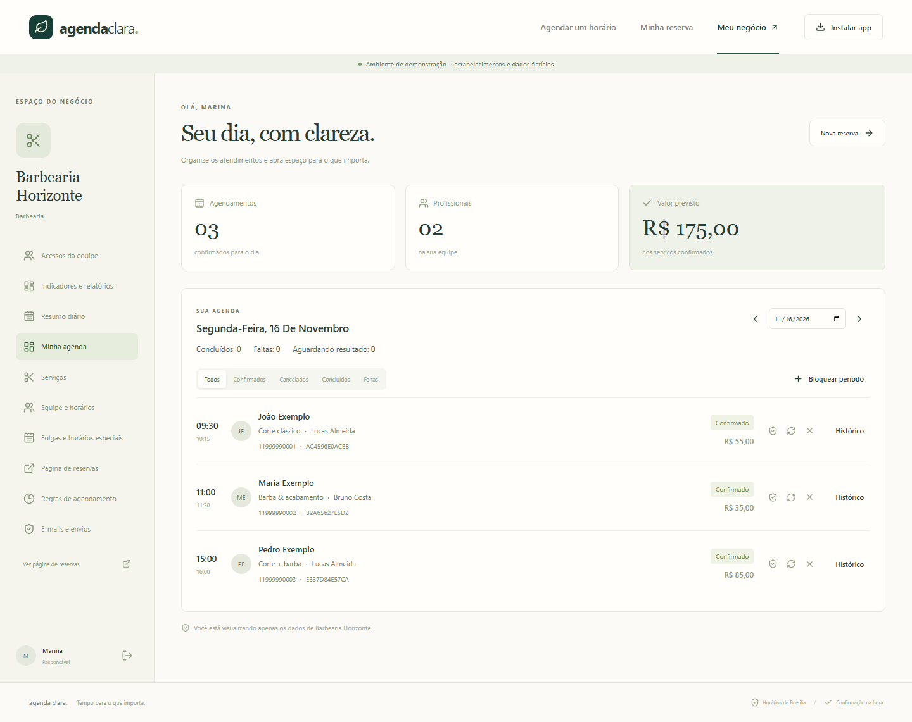
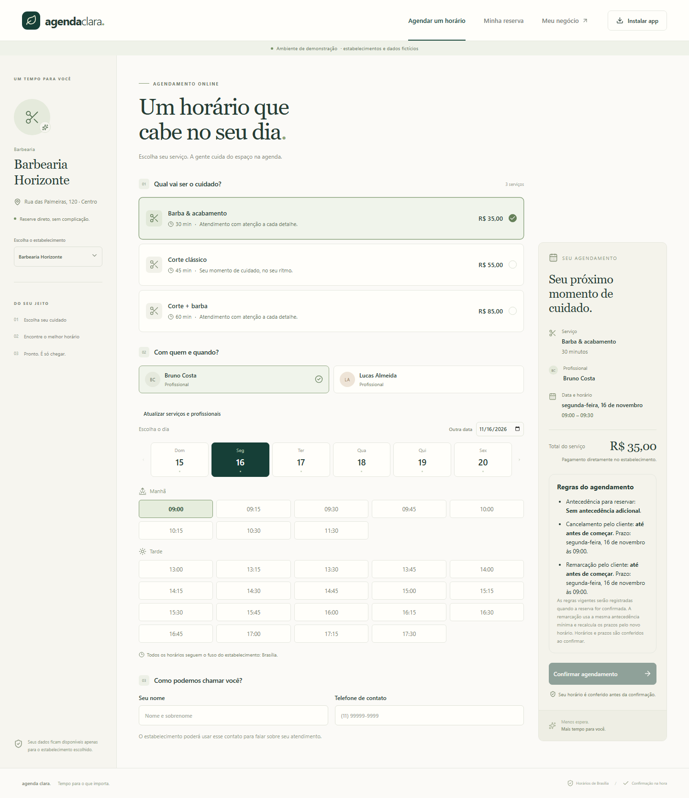
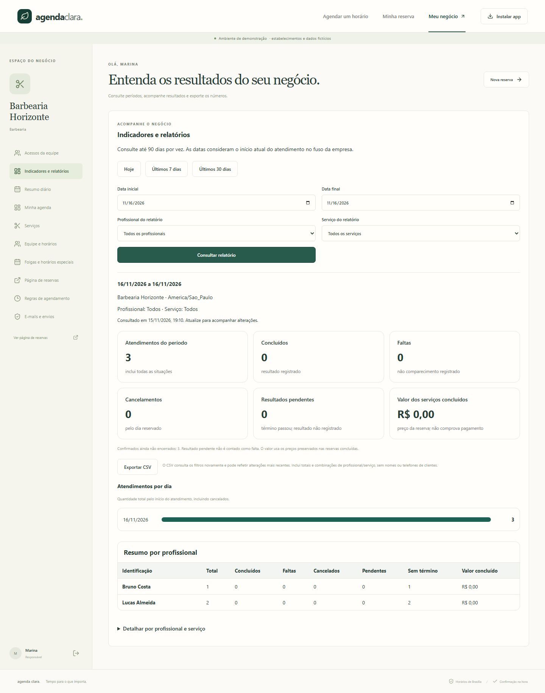
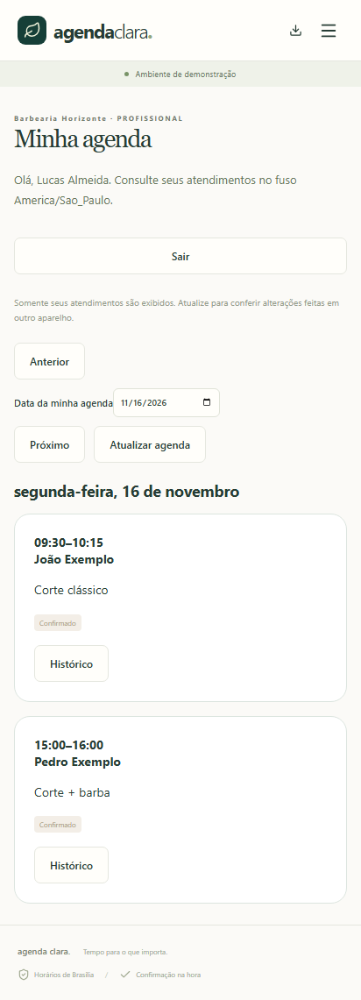

# Agenda Clara

Sistema de agendamento para pequenos negócios, com reservas públicas, gestão da empresa e acesso próprio dos profissionais. Organiza serviços e atendimentos com regras verificadas no servidor e proteção contra alterações simultâneas.

**[Experimentar online](https://agenda-clara-luizcodebr.onrender.com) · [Baixar o pacote local](https://github.com/LuizCodeBR/AgendaClara/releases/tag/v0.15.1) · [Decisões técnicas](docs/DECISOES-TECNICAS.md) · [Roteiro de apresentação](docs/PORTFOLIO.md)**

**Status:** escopo de portfólio concluído na versão **0.15.1**, em manutenção corretiva. Melhorias futuras partem de problemas reproduzíveis ou de uma necessidade concreta. A demonstração utiliza exclusivamente dados fictícios.

## Experimentar em poucos minutos

### Online, sem instalar

1. Abra o [site](https://agenda-clara-luizcodebr.onrender.com) e escolha **Agendar um horário**.
2. Selecione estabelecimento, serviço, profissional, data e horário; confirme com dados fictícios.
3. Em **Meu negócio**, selecione uma conta de demonstração para consultar agenda e relatórios.

| Empresa fictícia | E-mail | Senha pública de demonstração |
| --- | --- | --- |
| Barbearia Horizonte | marina@demo.agendaclara.dev | Demo@12345 |
| Estúdio Aurora | rafael@demo.agendaclara.dev | Demo@12345 |

A hospedagem gratuita pode precisar de tempo para iniciar após inatividade. Site e PWA usam o mesmo banco online. Para avaliar o acesso profissional, o responsável gera um convite em **Acessos da equipe**; abra-o em janela privada para ativar uma conta separada. [Guia de acessos](docs/ACESSO-PROFISSIONAIS.md).

### Pacote local, somente Java

Requer **Java 21 a 27**. Baixe **AgendaClara-0.15.1-demo.zip** na [release](https://github.com/LuizCodeBR/AgendaClara/releases/tag/v0.15.1), extraia em pasta gravável e execute:

- Windows: abra iniciar-demo.cmd.
- Linux/macOS: execute bash iniciar-demo.sh.

Acesse **http://localhost:8080** e mantenha o terminal aberto. Use **Ctrl+C** para encerrar. Inclui interface, servidor e H2 em arquivo; não exige Node, Maven, Docker ou banco instalado. Cada instalação mantém seu próprio banco.

### Código-fonte

Requer **JDK 21 a 27** e **Node.js 24.18+ da linha 24, ou 26+**. Maven Wrapper incluído. A primeira compilação baixa dependências pela internet.

No Windows, para manter projeto e caches no D:

~~~powershell
git clone https://github.com/LuizCodeBR/AgendaClara.git D:\Projetos\AgendaClara
Set-Location D:\Projetos\AgendaClara
.\iniciar.cmd
~~~

Se já possui o código, abra a pasta existente. Em execuções seguintes, use .\iniciar.cmd -SkipBuild; para outra porta, acrescente -Port 8081.

Linux/macOS, na pasta clonada ou extraída:

~~~bash
chmod +x mvnw iniciar.sh scripts/build.sh
./iniciar.sh
# Depois da primeira compilação:
./iniciar.sh --skip-build
~~~

Os iniciadores usam pastas locais para dependências e temporários. Navegador, editor e sistema operacional mantêm suas próprias configurações de armazenamento.

## Funcionalidades

| Área | Comportamento implementado |
| --- | --- |
| Reservas | Disponibilidade por serviço/profissional, confirmação, link privado do cliente, cancelamento e remarcação |
| Equipe e expediente | Serviços por profissional, horários semanais, intervalos, bloqueios, folgas e exceções por data |
| Regras por empresa | Antecedência mínima e prazos de cancelamento/remarcação, preservados na reserva |
| Contas e permissões | Cadastro da empresa, responsável, convites profissionais, Minha agenda e revogação |
| Atendimentos | Conclusão e falta após o término previsto, correções com justificativa e histórico |
| Gestão | Resumo diário com WhatsApp manual, indicadores por período, filtros e CSV |
| Recuperação e operação | Links de uso único, fila persistente de e-mails, banco versionado e backup criptografado |

O cliente gerencia sua reserva por link privado. O responsável administra a empresa. O profissional consulta e registra resultados somente dos próprios atendimentos, com histórico reduzido. Preços e duração são calculados no servidor; editar o catálogo não reescreve os valores preservados nas reservas.

## Telas

Capturas da aplicação **0.15.1** com banco local novo, API real e dados fictícios. As datas são as do registro das imagens.

| Reserva no navegador | Indicadores por período |
| --- | --- |
|  |  |

**Minha agenda no celular — acesso do profissional:**

[Galeria completa, origem e reprodução das capturas](docs/imagens/README.md).

## Decisões que o projeto demonstra

- **Uma entrega para web e local:** React servido pelo Spring Boot, API na mesma origem e distribuição em um JAR.
- **Reserva concorrente:** transação e bloqueio antes de conferir sobreposição; disponibilidade revalidada ao confirmar.
- **Repetição e edição concorrente:** chave da tentativa reconhece repetições e versões recusam comandos sobre dados antigos.
- **Permissões e revogação:** empresa e profissional vêm da sessão; a conta é revalidada nas gravações sensíveis.
- **Histórico e relatórios:** alteração e histórico gravados juntos, valores preservados e CSV sem dados pessoais de clientes.
- **Recuperação operacional:** fila transacional, conteúdo protegido, migrações e provas de backup/restauração.

O [registro das decisões](docs/DECISOES-TECNICAS.md) explica contexto, implementação, alternativas e limites com links para código e testes.

## Arquitetura e tecnologias

**Java 21 / Spring Boot 4.1.2 · Spring Security · Spring JDBC · Flyway · PostgreSQL 17 / H2 · React 19 / TypeScript / Vite · JUnit / Vitest / Playwright**

~~~mermaid
flowchart LR
    C[Cliente] --> UI[React / PWA]
    R[Responsável] --> UI
    P[Profissional] --> UI
    UI -->|mesma origem /api| APP[Spring Boot]
    APP --> DB[(PostgreSQL online / H2 local)]
    APP --> FILA[Fila persistente de e-mails]
    FILA --> DB
    APP --> BK[Backup sob demanda]
~~~

Organização por funcionalidades em [backend](backend/src/main/java/br/com/luizcode/agenda) e [frontend](frontend/src), com execução e distribuição em [scripts](scripts). [Arquitetura detalhada](docs/ARQUITETURA.md) · [Contrato da API](docs/API.md).

## Qualidade e evidências

Resultados da validação da **0.15.1**, registrados em 15/11/2026:

| Verificação | Resultado |
| --- | --- |
| Backend local, Windows/H2 | 411 casos: 408 aprovados e 3 condicionais não aplicáveis; zero falhas |
| Backend PostgreSQL, Java 21 e 26 na CI | 411 casos por configuração: 410 aprovados e 1 condicional; zero falhas |
| Interface | 181 testes aprovados |
| Navegador | 40 cenários aprovados em desktop e Pixel 7 emulado |
| Entrega e recuperação | Docker/PostgreSQL, pacote oficial, 12 rotinas HTTP e 7 provas após restauração aprovados |

[CI de referência](https://github.com/LuizCodeBR/AgendaClara/actions/runs/43758801503) · [Validação completa](docs/VALIDACAO-0.15.1.md) · [Revisão dos acessos](docs/REVISAO-ACESSOS-0.15.1.md). As contagens descrevem a versão validada; não são uma medida de cobertura percentual.

Para testar e compilar, na raiz:

~~~powershell
# Windows
powershell -NoProfile -ExecutionPolicy Bypass -File .\scripts\build.ps1
~~~

~~~bash
# Linux/macOS
bash scripts/build.sh
~~~

Playwright exige a aplicação em execução e o Chromium de testes. Consulte [Desenvolvimento](docs/DESENVOLVIMENTO.md) para testar a API, executar o navegador, usar Docker/PostgreSQL e manter o cache no D:. Os testes Java usam banco separado; TEST_DB_URL deve apontar exclusivamente para banco descartável.

## Web, mobile e limites da demonstração

A versão mobile é uma **PWA responsiva**, instalável pelo navegador compatível. Precisa de conexão com o servidor para consultar e alterar a agenda. O service worker oferece reconexão e não armazena respostas privadas da API nem enfileira reservas offline.

Site em Render Free e Neon Free, sujeito às cotas. Banco local independente do online, sem sincronização entre eles. Em outro aparelho, use o site HTTPS: localhost aponta para o próprio aparelho.

E-mails usam caixa privada de demonstração; envio real depende do provedor/remetente. WhatsApp manual. Relatórios mostram valores de serviços, não recebimentos. Mobile testado por emulação; uso com clientes reais requer validação operacional própria. [Web e mobile](docs/WEB-MOBILE.md).

## Dados e backups

H2 local em data/; dependências e temporários em .cache/; ambos ignorados pelo Git. Preserve data e a chave mail-outbox.key. Com o servidor local encerrado, execute backup.cmd ou bash backup.sh e siga o guia para verificar e restaurar em outro destino.

Backups e relatórios de limites são **sob demanda**, sem agenda recorrente. Não execute 0.14.1 ou anterior sobre banco V13 com contas profissionais: recuperação de versão antiga exige backup compatível em destino separado. [Armazenamento](docs/ARMAZENAMENTO-BACKUPS.md) · [Operação sob demanda](docs/OPERACAO-BACKUPS-LIMITES.md) · [Persistência gratuita](docs/PERSISTENCIA-GRATUITA.md).

## Documentação para explorar

| Interesse | Leitura |
| --- | --- |
| Apresentar em entrevista ou demonstração | [Portfólio e roteiro](docs/PORTFOLIO.md) |
| Entender escolhas e limites | [Decisões técnicas](docs/DECISOES-TECNICAS.md) |
| Executar, testar e usar bancos opcionais | [Desenvolvimento](docs/DESENVOLVIMENTO.md) |
| Operar o agendamento | [Regras](docs/REGRAS-AGENDAMENTO.md), [Minha reserva](docs/MINHA-RESERVA.md), [Resultados](docs/RESULTADOS-ATENDIMENTOS.md) |
| Configurar empresa e equipe | [Cadastro](docs/CADASTRO-EMPRESAS.md), [Profissionais](docs/PROFISSIONAIS.md), [Acessos](docs/ACESSO-PROFISSIONAIS.md) |
| Acompanhar o negócio | [Resumo diário](docs/RESUMO-DIARIO.md), [Relatórios](docs/RELATORIOS.md), [Fila de e-mails](docs/FILA-EMAILS.md) |

Notas e validações anteriores permanecem em [docs](docs). O [fechamento do portfólio](docs/FECHAMENTO-PORTFOLIO.md) registra esta apresentação. O ciclo funcional está concluído; a referência executável continua sendo a release **0.15.1**.
