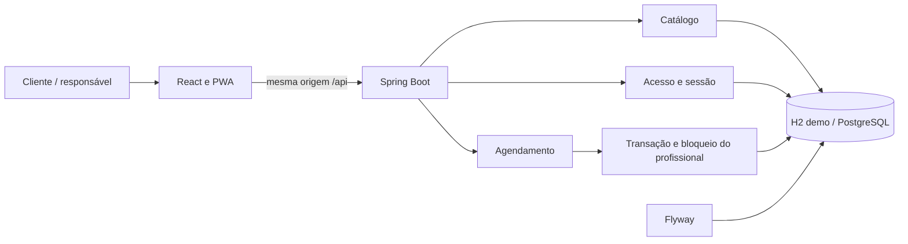

# Arquitetura — Agenda Clara

## Decisão principal

A primeira versão é um **monólito organizado por funcionalidades**, em um repositório. A interface e a API são desenvolvidas separadamente, mas o resultado da interface entra no mesmo JAR do servidor.

Isso reduz os passos para experimentar o projeto: uma URL, um processo Java e um banco local. Os módulos podem evoluir sem exigir microsserviços ou infraestrutura distribuída na primeira entrega.

## Responsabilidades

| Pacote | Responsabilidade |
| --- | --- |
| catalog | Estabelecimentos, serviços, profissionais e expediente |
| identity | Login, sessão, CSRF, limites de requisições e identificação do responsável |
| team | Cadastro e configuração transacional de profissionais e expediente |
| scheduling | Disponibilidade, reservas, remarcações, cancelamentos e bloqueios |
| bootstrap | Dados fictícios ativados explicitamente pela configuração de demonstração |
| shared | Respostas de erro e políticas comuns da API |

Os controladores traduzem HTTP. O serviço de agendamento coordena as regras e a transação. Os repositórios executam consultas SQL com parâmetros. DTOs públicos não expõem o modelo interno nem hashes.

## Modelo de dados

- business: identificação pública e fuso do estabelecimento.
- app_user: responsável vinculado a um estabelecimento.
- professional: profissional pertencente ao estabelecimento.
- service_offering: serviço, duração e preço em centavos.
- weekly_hours: janelas de expediente por profissional e dia da semana.
- appointment: reserva, estado, cliente, valores e dados de repetição segura.
- time_block: indisponibilidade explícita por profissional.

Chaves estrangeiras compostas validam os pares `(professional_id, business_id)` e `(service_id, business_id)`. Assim, o banco rejeita relações entre empresas diferentes mesmo se uma chamada tentar misturá-las.

## Reserva e concorrência

Disponibilidade é uma consulta informativa: entre exibir um horário e confirmar, outra pessoa pode ocupá-lo.

A confirmação revalida tudo, dentro de uma transação em **READ COMMITTED**:

1. Localiza e bloqueia a linha do profissional, com `SELECT ... FOR UPDATE`, já filtrada pelo estabelecimento.
2. Procura uma requisição anterior com a mesma chave.
3. Obtém a duração e o preço no servidor.
4. Verifica data, antecedência, grade e expediente.
5. Procura sobreposição com reservas confirmadas e bloqueios.
6. Grava a reserva e confirma a transação.

Todas as alterações da agenda — inclusive bloqueio, cancelamento e remarcação — seguem o mesmo bloqueio por profissional. A serialização é realizada pelo banco e funciona entre processos diferentes conectados ao mesmo banco. Profissionais diferentes podem ser atendidos em paralelo.

Os intervalos são tratados como `[início, fim)`: um atendimento que termina às 10h permite outro começando às 10h.

A regra de sobreposição é `inícioA < fimB && fimA > inícioB`. Alterar o horário inicial não permite atravessar uma reserva já existente.

**Limite da garantia:** a regra depende de todos os escritores usarem esse protocolo. Uma alteração manual diretamente nas tabelas não passa pelo serviço. Não há uma restrição de exclusão temporal específica do PostgreSQL nesta versão.

## Repetição segura

Cada tentativa de confirmação usa um UUID gerado pela interface. Uma assinatura SHA-256 representa profissional, serviço, instante e contato normalizado. A chave é única dentro do estabelecimento.

- Mesma chave e mesmos dados: devolve a mesma reserva.
- Mesma chave e dados diferentes: conflito 409.
- Repetição de uma reserva já cancelada: conflito; não é apresentada como confirmada.
- Nova confirmação após escolher novamente: nova chave.

A interface mantém a chave após falha de conexão, porque a reserva pode ter sido gravada antes de a resposta se perder.

## Datas e valores

Instantes são armazenados em UTC com tipo SQL que inclui fuso/offset. Expediente e dias são interpretados no fuso do estabelecimento. Na demonstração, ambos usam `America/Sao_Paulo`.

O servidor rejeita inícios fora da grade de 15 minutos. Horários locais inexistentes ou ambíguos em transições de fuso não são oferecidos. A versão não permite expediente atravessando a meia-noite.

Preços são inteiros em centavos. A reserva guarda nome do serviço, preço e duração efetivamente contratados para preservar seu histórico.

## Acesso

O cliente reserva sem criar conta. O responsável entra no painel com uma sessão do Spring Security. O cookie de sessão é HttpOnly e SameSite=Lax. As senhas são guardadas com BCrypt.

Sessão foi escolhida porque a primeira versão é uma aplicação de mesma origem. Evita guardar tokens de acesso em localStorage e simplifica o encerramento da sessão. Uma API para aplicativos externos pode exigir outra decisão futuramente.

Alterações exigem CSRF. A interface busca o token antes de enviar cada alteração, inclusive login e reserva pública. O identificador da empresa no painel vem do usuário autenticado; não é aceito como autorização pelo corpo da requisição.

Disponibilidade pública contém horários livres, sem nomes, telefones ou identificadores das reservas. Respostas da API usam `Cache-Control: no-store`.

## PWA e limites

O manifesto fornece nome, ícones e modo standalone. O service worker mantém somente a página de reconexão e ícones. Não há cache de API, fila de reservas ou confirmação sem comunicação com o servidor.

Instalação no navegador não cria um serviço nativo em segundo plano. Na demonstração, o Java precisa continuar aberto. A URL pública HTTPS permite instalar a PWA em aparelhos diferentes.

## Evolução planejada

A gestão de profissionais e expediente foi implementada na versão 0.2.0. Perfil e semana são salvos em uma única transação; atendimentos confirmados futuros ou em andamento precisam caber no novo expediente. Inativação é recusada enquanto existirem esses compromissos. Reservas e configuração usam o mesmo bloqueio de linha; o campo version recusa edições desatualizadas. A migração V2 acrescenta active e version sem apagar cadastros. Consulte [PROFISSIONAIS.md](PROFISSIONAIS.md).

Verificação de e-mail e recuperação de acesso estão implementadas. Uma entrega para clientes reais ainda exige configurar e validar envio real, ampliar proteção contra abuso e preparar hospedagem HTTPS, persistência e operação. O Compose atual é uma opção local, com configurações fictícias.

## Revisão 0.2.1

Um filtro dentro da cadeia de segurança, antes de CSRF e autenticação, limita frequência e tamanho das requisições. O controle tem memória limitada e utiliza tempo monotônico, sem confiar em cookies ou cabeçalhos de IP para decidir cotas globais. O usuário autenticado implementa remoção de credenciais após login.

Catálogo, disponibilidade e agenda diária passam a usar transações somente de leitura em REPEATABLE READ. A gravação continua em READ COMMITTED com bloqueio por profissional. Busca por um identificador usa SQL direto e parametrizado; a equipe completa utiliza duas consultas por estabelecimento, sem uma consulta adicional para cada profissional.

A interface web/PWA compartilha a mesma comunicação com a API, inclusive mensagens de espera e limites. Nenhuma nova dependência ou migração de banco foi necessária. Consulte o [relatório de revisão](REVISAO-SEGURANCA-0.2.1.md).

## Folgas e expediente por data (0.3.0)

O módulo hours acrescenta date_hours e date_hours_window pela migração V3. A chave diária é única por estabelecimento, profissional e data; as relações possuem chaves compostas para impedir mistura entre empresas.

EffectiveHours resolve os intervalos da data: uma exceção substitui a semana; uma exceção sem intervalos fecha o dia. Disponibilidade, confirmação e remarcação usam o mesmo serviço. Os bloqueios continuam sendo descontados.

Alterações diárias e semanais compartilham o bloqueio da linha do profissional com as reservas. A versão otimista também é compartilhada. Antes de gravar ou remover uma exceção, o serviço verifica os atendimentos confirmados futuros e em andamento. Editar a semana respeita os horários específicos das datas dos compromissos.

O GET administrativo retorna versão, limites de datas, semana e exceções dentro de uma transação de leitura. A consulta das exceções é limitada ao período configurável; a validação da semana busca as exceções dos compromissos em uma consulta, evitando uma busca por agendamento.

O H2 foi atualizado de 2.4.240 para 2.5.252 após um teste reproduzir o defeito de validação de CHECK ao trocar conexões. A regressão permanece coberta, e uma atualização real de arquivo V2 para V3 foi conferida com dados fictícios. Consulte [EXCECOES.md](EXCECOES.md).

## Empresas e contas (0.4.0)
O cadastro e a publicação funcionam pela mesma interface no site, celular/PWA e instalação local. Consulte [CADASTRO-EMPRESAS.md](CADASTRO-EMPRESAS.md) para o fluxo, persistência e limites.
## Confirmação e recuperação (0.5.0)
A migração V5 acrescenta tokens de uso único, confirmação real/simulada separadas, prova de caixa de teste e versão das credenciais. Emissão e consumo bloqueiam o usuário e mensagens só são entregues após commit. O filtro CredentialVersionFilter recusa sessões anteriores à recuperação, usando o caminho canônico e uma consulta por chamada autenticada à API. Catálogo público e publicação respeitam a confirmação exigida para contas novas no modo atual. A interface remove tokens da barra de endereço e exige confirmação explícita.

Na entrega 0.5.0, o envio externo usava HTTP para Resend e fila limitada em memória. Essa fila foi substituída pela outbox persistente na versão 0.6.0 descrita abaixo. O modo demo não dispara e-mails e sua caixa privada tem cookie separado da sessão de login. Consulte [EMAIL-ACESSO.md](EMAIL-ACESSO.md).
## Outbox e monitoramento (0.6.0)

A migração V6 cria outbox, heartbeat do processador e vínculo da chave à instalação. O listener BEFORE_COMMIT grava a mensagem criptografada na mesma transação de emissão do link ou mudança de senha. A falha da fila provoca rollback conjunto.

O scheduler interno consulta a fila a cada segundo. A seleção transacional usa FOR UPDATE SKIP LOCKED e concessão de 60 segundos; a conclusão exige o mesmo lease_token. O envio HTTP ocorre fora da transação. Conteúdo e identificador são estáveis entre tentativas, que cessam na validade do link ou 23 horas após a criação. Há três tentativas automáticas e um ciclo manual elegível.

AES-256-GCM protege o snapshot da mensagem, com nonce aleatório e AAD vinculando seus identificadores. A chave fica em arquivo protegido ou segredo de ambiente, separada do banco. O vínculo no banco impede instâncias com chaves diferentes; não há rotação automática.

Mensagens reais aceitas descartam o conteúdo; mensagens de teste/falhas têm conteúdo limpo na validade. Metadados expiram após sete dias e heartbeat antigo é removido. O H2 local usa WRITE_DELAY=0. Compose preserva a chave em volume próprio junto à persistência do PostgreSQL.

O monitor usa leitura REPEATABLE READ, filtra por empresa da sessão e retorna somente metadados, 50 registros e totais. Falha, atraso ou ausência de verificação recente geram atenção no painel. Não há alerta externo nem confirmação de recebimento por webhook. Consulte [FILA-EMAILS.md](FILA-EMAILS.md).

## Revisão de concorrência (0.6.1)
A espera do provedor permanece em next_attempt_at após falha definitiva do ciclo e é validada também na repetição manual. O processador confere atividade e manutenção entre mensagens. A leitura/criação da chave local de demonstração usa coordenação na JVM e bloqueio de arquivo entre processos, com permissões antes de escrever e sincronização do conteúdo. Não houve migração de esquema. Consulte [a revisão](REVISAO-SEGURANCA-0.6.1.md).

## Armazenamento e recuperação (0.7.0)
Ferramentas de backup executam por modo de linha de comando antes da inicialização do Spring, sem endpoint HTTP de exportação integral. Arquivos ACBK0001 usam AES-256-GCM e derivação PBKDF2-HMAC-SHA256, guardando banco e chave com manifesto autenticado e hashes. H2 exige banco fechado e bloqueio exclusivo do arquivo; PostgreSQL usa pg_dump custom e pg_restore em transação única para banco vazio. A restauração não substitui instalação existente. STORAGE_MODE explicita o ambiente; persistent exige PostgreSQL e segredo estável para envio ativo. Consulte [ARMAZENAMENTO-BACKUPS.md](ARMAZENAMENTO-BACKUPS.md).

## Serviços por profissional (0.9.0)

A migração V7 cria professional_service com chave por estabelecimento/profissional/serviço e FKs compostas. A configuração da equipe grava os vínculos junto do perfil e semana, sob o bloqueio e version já existentes. Disponibilidade, reserva e remarcação validam a associação. A publicação exige serviço e expediente no mesmo profissional ativo. A migração preserva as combinações anteriores; novos cadastros exigem escolha explícita. Consulte [SERVICOS-PROFISSIONAIS.md](SERVICOS-PROFISSIONAIS.md).

## Acesso privado do cliente (0.10.0)

A migração V8 cria appointment_access e appointment_customer_session com chaves compostas por reserva/estabelecimento, controle de geração, hashes únicos e sequência de sessões. Acrescenta version na reserva. O link usa HMAC-SHA256 com chave HKDF derivada por finalidade da chave estável existente; sessões usam segredos aleatórios independentes. Segredos brutos não são gravados no banco.

CustomerPortalService valida concessão e reserva antes e depois do bloqueio de profissional. O mesmo bloqueio coordena cancelamento, remarcação, emissão e revogação com as demais alterações de agenda. A versão esperada evita sobrescrita de telas antigas. Consultas usam snapshot consistente; alterações usam READ_COMMITTED e revalidação depois da espera.

O navegador troca o segredo do fragmento por cookie HttpOnly restrito ao caminho da reserva. A URL seguinte contém somente o UUID não secreto. Duas reservas no mesmo navegador mantêm sessões independentes. A interface e o service worker não persistem respostas privadas. Consulte [o guia](MINHA-RESERVA.md).

## Regras por empresa (0.11.0)

V9 acrescenta os intervalos de reserva, cancelamento e remarcação e sua revisão em business. appointment guarda uma cópia imutável desses valores. Defaults zero preservam o histórico.

BookingPolicyService coordena edição e captura com um UPDATE de coluna não chave na empresa, antes de bloquear o profissional na confirmação. A revisão é relida após a espera. O servidor verifica publicação, antecedência e disponibilidade na mesma transação. O caminho público reconfirma a publicação; a preparação interna de cadastros privados permanece separada.

CustomerPortalService aplica as condições da reserva e calcula permissões e prazos individuais. A remarcação preserva valores e recalcula datas pelo novo início. O responsável pode atender exceções futuras. Relógio do servidor e instantes garantem limites precisos; a interface mostra o fuso da empresa. Consulte [o guia](REGRAS-AGENDAMENTO.md).
