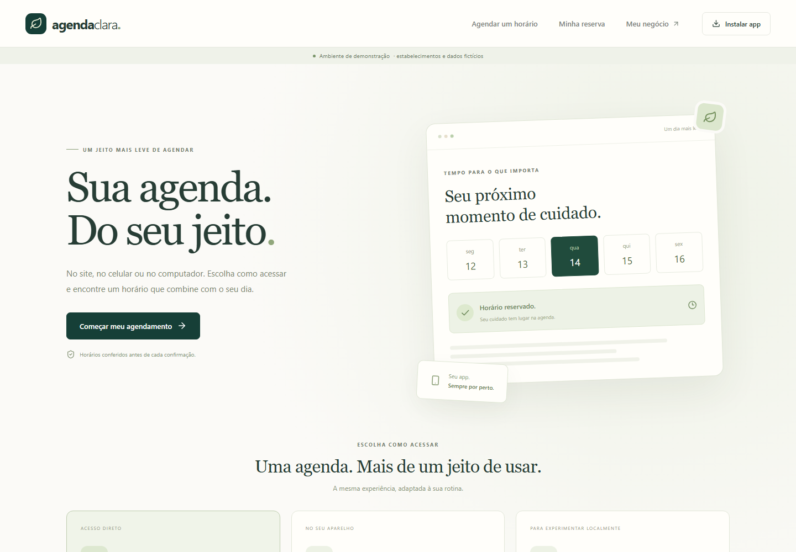
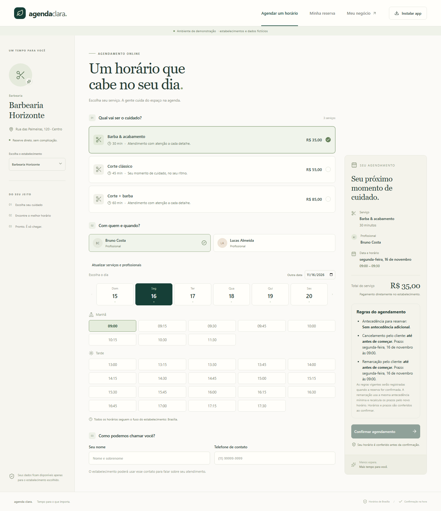
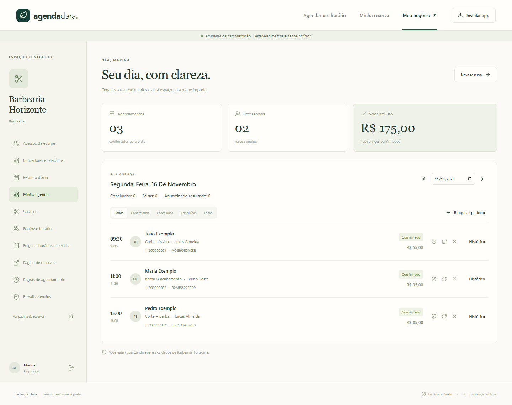
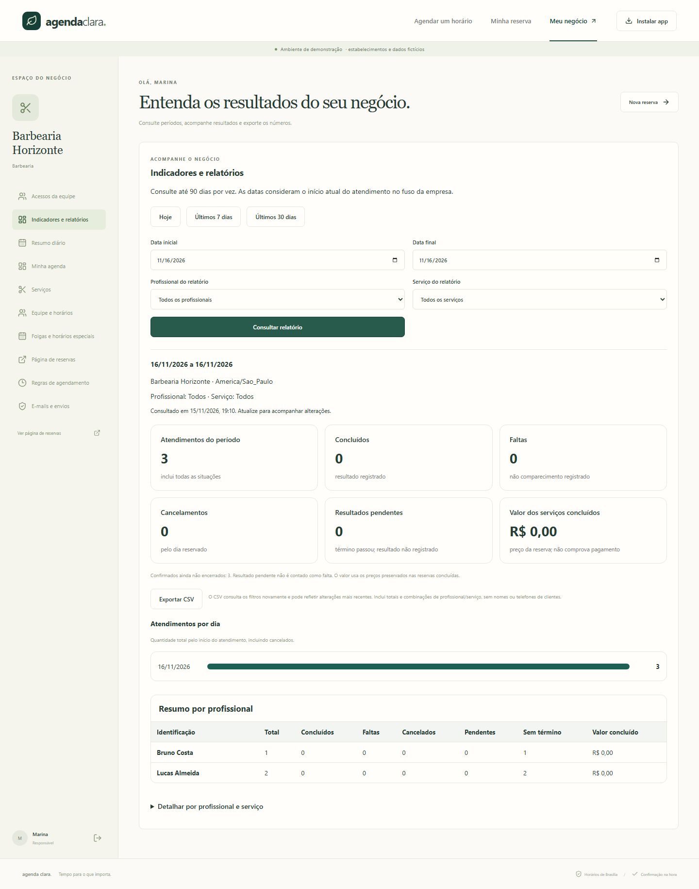
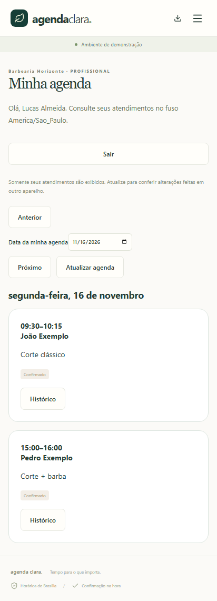
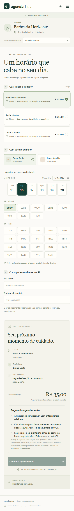

# Capturas — Agenda Clara 0.15.1

Aplicação compilada real, capturada em 15/11/2026. Perfil demo, H2 novo e separado, exemplos exclusivamente fictícios. API e conteúdo visual sem mocks. Atendimentos em 16/11/2026; o calendário avança normalmente em outras execuções.

O responsável vê os três exemplos da Barbearia Horizonte. A conta de Lucas Almeida foi ativada para a captura: Minha agenda mostra João e Pedro; Maria pertence a Bruno. O acesso criado foi revogado ao terminar.

## Galeria

### 1. Início no computador

Entrada para reservar e conhecer as formas de acesso. A ilustração faz parte da própria interface.

### 2. Reserva no computador

Serviço, profissional, data, disponibilidade e regras. Nenhuma reserva foi confirmada para a imagem.

### 3. Agenda do responsável

Três atendimentos fictícios, dois profissionais e valor previsto dos serviços confirmados.

### 4. Indicadores e relatórios

Três reservas futuras, sem resultados concluídos. R$ 0,00 em serviços concluídos está correto para esse conjunto; o gráfico não representa movimentação financeira.

### 5. Minha agenda no celular

Pixel 7 emulado. Somente os dois atendimentos de Lucas; sem telefone, preço ou link privado do cliente.

### 6. Reserva no celular

A mesma funcionalidade pública em tela estreita, com serviços, equipe, horários, formulário e resumo.

## Integridade e conferência

[capturas.json](capturas.json) registra versão, instante, data, resolução, tamanho e SHA-256 de cada PNG. Desktop: viewport 1440 × 1000; mobile: 412 × 839, Pixel 7 emulado com escala 1. Páginas completas têm altura maior que o viewport.

A rotina espera fontes e conteúdo, verifica ausência de alertas e rolagem horizontal e não publica senhas, tokens, cookies ou links privados. As seis imagens foram inspecionadas visualmente. Emulação não equivale a teste físico.

## Reproduzir localmente

Requer dependências do frontend e Chromium do Playwright; nenhuma extensão do editor. Ambos já estão instalados neste computador. Use **diretório de dados novo e descartável**. A rotina recusa origem externa, modo diferente de demo/local, versão diferente de 0.15.1 e equipe com acessos existentes.

Na raiz, depois de compilar, inicie uma instância separada em um terminal:

~~~powershell
$env:TEMP = 'D:\Projetos\AgendaClara\.cache\tmp'
$env:TMP = $env:TEMP
$env:AGENDA_DATA_DIR = 'D:\Projetos\AgendaClara\.cache\portfolio-nova-captura'
java '-Djava.io.tmpdir=D:\Projetos\AgendaClara\.cache\tmp' -jar target/agenda-clara-0.15.1.jar --spring.profiles.active=demo --server.port=8092
~~~

Escolha uma pasta AGENDA_DATA_DIR que ainda não tenha sido usada. Em outro terminal, na mesma raiz:

~~~powershell
$env:TEMP = 'D:\Projetos\AgendaClara\.cache\tmp'
$env:TMP = $env:TEMP
$env:PLAYWRIGHT_BROWSERS_PATH = 'D:\Projetos\AgendaClara\.cache\browsers'
$env:AGENDA_PORTFOLIO_CAPTURE = 'DADOS_FICTICIOS'
node scripts/capturar-portfolio.mjs http://127.0.0.1:8092
~~~

A rotina cria conta fictícia pelas APIs reais, captura, revoga e fecha o navegador. Substitui os seis PNGs e o manifesto nesta pasta; não copia dados do site nem gera segredos em arquivos. Encerre o servidor com Ctrl+C. Para instalar Chromium em outra máquina, consulte [Desenvolvimento](../DESENVOLVIMENTO.md).
